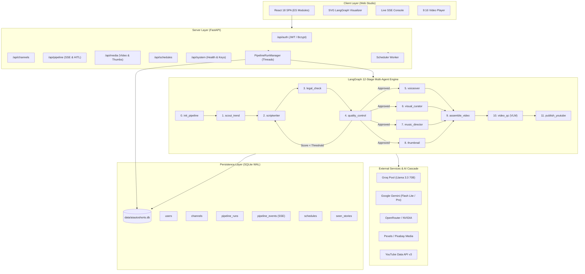
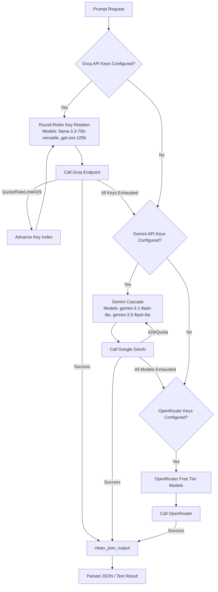

# AIAutoShorts: Master Core Architecture & System Specification

> **Version:** 1.0.0  
> **Target Output:** 1080×1920 Vertical Shorts (9:16), 60 FPS, High-Retention Audio Ducking, ASS Karaoke Subtitles  
> **Status:** Production-Grade

---

## 1. Executive Summary & Mission

**AIAutoShorts** is an autonomous, multi-tenant AI video production platform designed to generate, validate, assemble, and publish viral YouTube Shorts from scratch. 

Moving beyond experimental single-file prototypes, AIAutoShorts is engineered with:
- A **StateGraph multi-agent orchestrator** (LangGraph) featuring cyclic self-correction loops and Human-in-the-Loop (HITL) approval gates.
- A **multi-provider AI cascade engine** with automatic key rotation and multi-tier failovers across Groq, Google Gemini, OpenRouter, and NVIDIA NIM.
- A **persistent, normalized SQLite storage engine** configured with Write-Ahead Logging (`WAL`), foreign keys, and write-retry backoff decorators.
- A **modular, zero-build React 18 Web Studio** utilizing native browser ES Modules, Tailwind CSS, live Server-Sent Events (SSE) log streaming, interactive SVG topology rendering, and a 9:16 vertical video player.
- A **hardware-accelerated FFmpeg media pipeline** with automated audio ducking, offline CLIP vision-language footage validation, and NVIDIA NVENC encoding.

---

## 2. Technical Stack

| Layer | Technologies | Key Architectural Decisions |
| :--- | :--- | :--- |
| **Runtime & Backend** | Python 3.10+ / 3.14, FastAPI, Uvicorn, Pydantic v2 | Fully async REST server with thread-pool background worker management. |
| **Multi-Agent Orchestrator** | LangGraph StateGraph, TypedDict state | 12-stage acyclic + cyclic StateGraph with dynamic script revision loops. |
| **Database & Persistence** | SQLite 3 (WAL Mode), Thread-Safe Repository | Normalized schema (`users`, `channels`, `pipeline_runs`, `pipeline_events`, `schedules`, `seen_stories`, `ab_tests`, `ai_reviews`). |
| **AI & LLMs** | Unified Multi-Provider Client (`core/ai_client.py`) | Groq API round-robin key pool $\to$ Gemini model cascade $\to$ OpenRouter $\to$ NVIDIA NIM. Resilient JSON extraction and repair. |
| **Voiceover & Subtitles** | Edge-TTS, ElevenLabs (optional), OpenAI Whisper | Multi-speaker neural TTS, millisecond word-level timestamps, animated ASS karaoke subtitles. |
| **Visual Scraper & Vision** | Pexels API, Pixabay API, DuckDuckGo Media, CLIP | Offline CLIP ViT-B/32 semantic verification + Gemini VLM visual inspection. |
| **Video Rendering** | FFmpeg 6.0+, NVENC (`h264_nvenc`), libass | Hardware-accelerated 1080x1920 vertical auto-crop, dynamic audio ducking (-14 to -18 dB), flash frame thumbnails. |
| **Frontend Web Studio** | React 18, HTM (JSX-free native ESM), Tailwind CSS | Zero-build, instant page loads, SVG graph visualizer, reconnecting SSE live console. |
| **Scheduler** | Async Background Cron Service | Dynamic next-run calculation, channel-isolated task queuing. |

---

## 3. High-Level System Topology



---

## 4. Codebase Structure & Module Reference

```
d:\Projects\AIAutoShorts/
├── ARCHITECTURE.md                  # Master core architecture & system specification
├── README.md                        # User guide, quickstart & setup
├── requirements.txt                 # Verified Python dependencies
├── run.py                           # Unified runner (FastAPI web server & CLI executor)
│
├── config/
│   ├── __init__.py
│   ├── settings.py                  # Environment config, API key pools, hardware auto-detect
│   ├── bgm_discovery.json           # Curated mood-to-music discovery metadata
│   ├── phonetic_map.json            # SSML phonetic mappings for neural TTS pronunciation
│   └── bgm_defaults/                # 11 bundled royalty-free fallback audio tracks
│
├── core/
│   ├── __init__.py                  # Package exports (__version__, ChannelContext, etc.)
│   ├── ai_client.py                 # CANONICAL: Multi-provider AI client with key rotation & cascade
│   ├── gemini_client.py             # SHIM: Backward-compatibility bridge pointing to ai_client
│   ├── notifier.py                  # CANONICAL: Resilient notification & alert dispatcher
│   ├── telegram_bot.py              # SHIM: Backward-compatibility bridge pointing to notifier
│   ├── channel_context.py           # Database-backed channel configuration loader
│   ├── channel_dna.py               # ChannelType enumeration and niche-detection heuristics
│   ├── script_generator.py          # 3-act viral script generator with strict timing rules
│   ├── voiceover.py                 # Multi-tier TTS (Edge-TTS, ElevenLabs) + Whisper aligner
│   ├── ass_generator.py             # High-retention word-level animated karaoke ASS subtitle engine
│   ├── video_clipper.py             # Intelligent stock video scraper (Pexels, Pixabay, DDGS)
│   ├── video_assembler.py           # FFmpeg assembly engine (audio ducking, vertical crop, NVENC)
│   ├── trend_fetcher.py             # Google Trends / RSS scraper with deduplication
│   ├── youtube_uploader.py          # YouTube Data API v3 publisher with dry-run support
│   ├── experiment_engine.py         # A/B testing recipe generator for hooks and visual styles
│   ├── hybrid_validator.py          # 2-tier footage validator (Local CLIP + Gemini VLM)
│   ├── local_validator.py           # Offline OpenAI CLIP ViT-B/32 cosine similarity matcher
│   ├── retrieval_validator.py       # Candidate video asset validation coordinator
│   ├── image_scraper.py             # DuckDuckGo fallback scraper with Ken Burns motion generator
│   ├── ytdlp_utils.py               # yt-dlp cookie and client headers management
│   ├── log.py                       # Formatted terminal logging utilities
│   ├── utils.py                     # Safe atomic file replacement utilities
│   │
│   ├── agents/                      # Specialized Pipeline Agents
│   │   ├── __init__.py              # Agent exports (LegalAgent, QualityControlAgent, etc.)
│   │   ├── legal.py                 # Copyright & compliance assessment agent
│   │   ├── quality_control.py       # Creative scorecard & retention review agent
│   │   ├── music_director.py        # Mood matching & background audio scoring agent
│   │   ├── thumbnail_designer.py    # Thumbnail prompt, concept & text overlay designer
│   │   └── video_quality_reviewer.py# Gemini VLM post-render visual inspection agent
│   │
│   ├── db/                          # Persistence Engine
│   │   ├── __init__.py              # Repository exports
│   │   ├── schema.py                # Normalized SQLite DDL with WAL mode & indexes
│   │   └── repository.py            # Thread-safe database transactions & retry backoffs
│   │
│   └── graph/                       # LangGraph Orchestration
│       ├── __init__.py              # Graph exports (build_aiautoshorts_graph, State)
│       ├── state.py                 # TypedDict VideoProductionState and Scene models
│       ├── nodes.py                 # 12 LangGraph pipeline execution nodes
│       └── workflow.py              # StateGraph topology with conditional self-correction
│
├── server/
│   ├── __init__.py
│   ├── app.py                       # FastAPI application with lifespan management & static mounts
│   ├── manager.py                   # Thread-safe PipelineRunManager with SSE broadcast & HITL
│   ├── schemas.py                   # Pydantic v2 API request/response schemas
│   ├── auth/                        # Authentication & Multi-Tenancy
│   │   ├── __init__.py
│   │   ├── security.py              # Bcrypt hashing & timezone-aware UTC JWT tokens
│   │   └── service.py               # User registration, authentication & starter channel setup
│   ├── scheduler/                   # Automated Background Scheduler
│   │   ├── __init__.py
│   │   ├── manager.py               # Async cron worker thread
│   │   └── service.py               # Next-run calculation & schedule evaluation
│   └── routes/                      # REST API Endpoints
│       ├── __init__.py
│       ├── auth.py                  # User login, registration, /me
│       ├── channels.py              # Channel CRUD & live Edge-TTS voice testing
│       ├── pipeline.py              # Run trigger, SSE live logs, cancel, HITL approve/reject
│       ├── media.py                 # Video streaming, thumbnail serving, downloads
│       ├── schedules.py             # Recurring production job scheduling
│       ├── analytics.py             # Retention metrics, QC scorecards, A/B experiment data
│       └── system.py                # Health checks, disk space, API key validation
│
├── ui/                              # Modular React 18 Web Studio
│   ├── index.html                   # HTML5 shell, Tailwind CSS, native ES Modules importmap
│   └── src/
│       ├── main.js                  # React 18 root mounting
│       ├── App.js                   # Application layout shell, tab router, toast system
│       ├── html.js                  # HTM binding for JSX-free pure JavaScript React components
│       ├── api/
│       │   ├── client.js            # Fetch client with auto JWT injection
│       │   └── sse.js               # EventSource client with reconnect backoff
│       ├── context/
│       │   ├── AuthContext.js       # Global authentication provider
│       │   └── PipelineContext.js   # Live pipeline state & event stream provider
│       ├── components/
│       │   ├── Icons.js             # SVG icon set
│       │   ├── Navbar.js            # Top bar with status indicators & user profile
│       │   ├── Sidebar.js           # Navigation bar with badges
│       │   ├── WorkflowGraph.js     # Interactive 12-node SVG topology visualizer
│       │   ├── LiveConsole.js       # Real-time SSE streaming terminal with filtering
│       │   ├── ShortsVideoPlayer.js # 9:16 vertical video player modal
│       │   ├── CreateRunModal.js    # Interactive Short creation modal
│       │   ├── ChannelModal.js      # Channel editor with live Edge-TTS voice preview
│       │   ├── HITLReviewModal.js   # Human-in-the-Loop review & approval drawer
│       │   └── ScheduleModal.js     # Cron schedule editor modal
│       └── pages/
│           ├── DashboardPage.js     # System overview & recent pipelines
│           ├── StudioPage.js        # Real-time pipeline execution & live monitoring
│           ├── ChannelsPage.js      # Multi-tenant channel management
│           ├── GalleryPage.js       # Generated video library & playback
│           ├── SchedulesPage.js     # Automated production schedules
│           ├── AnalyticsPage.js     # Retention curves & A/B performance
│           ├── SettingsPage.js      # API keys health & hardware diagnostics
│           └── LoginPage.js         # Authentication & registration
│
└── tests/                           # Verification Suite
    ├── test_db.py                   # SQLite schema, transactions & idempotency
    ├── test_auth.py                 # JWT token generation & password security
    ├── test_graph.py                # LangGraph compilation & conditional routing
    └── test_api.py                  # FastAPI endpoints & health checks
```

---

## 5. Architectural Cleanups & Refactoring Record

During the transition from the experimental `AutoReel` prototype to `AIAutoShorts`, the following architectural issues were audited and resolved:

### Removed Vestigial Files
| File | Lines | Rationale for Removal |
| :--- | :--- | :--- |
| `core/db.py` | 7 | Shadowed the `core/db/` package directory, risking Python module import conflicts. `core/db/__init__.py` handles all repository exports. |
| `core/env_validator.py` | 44 | Prototype script that inspected Chromium profile paths and called `sys.exit(1)`. Superseded by `server/routes/system.py` and `config/settings.py`. |
| `core/experiment_tracker.py` | 151 | Flat SQLite tracker for obsolete `data/experiments.db`. Replaced by normalized `core/db/repository.py` (`ab_tests`, `pipeline_runs`). |
| `core/agents/analytics_agent.py` | 99 | Prototype CMO agent that targeted obsolete flat DB and messaged Telegram. Replaced by `server/routes/analytics.py` and SQLite metrics. |
| `core/agents/research_agent.py` | 136 | Prototype R&D agent writing to flat `winning_strategy.json`. Superseded by `trend_fetcher.py`. |
| `core/graph/runner.py` | 174 | Prototype CLI runner using volatile `MemorySaver`. Superseded by `run.py` and `server/manager.py`. |

### Refactored & Canonical Modules
| Target | Previous State | New Architecture |
| :--- | :--- | :--- |
| **Unified AI Client** | Named `core/gemini_client.py`, despite primarily orchestrating Groq API. | Canonicalized as `core/ai_client.py`. `core/gemini_client.py` retained as a clean re-export shim for backwards compatibility. |
| **Notification Engine** | 575 lines of interactive Telegram bot polling daemon in `core/telegram_bot.py`. | Canonicalized as `core/notifier.py` (40 lines of resilient alert dispatching). `core/telegram_bot.py` converted into a backward-compatible shim. |
| **Package Initializers** | Missing `core/__init__.py` and `core/agents/__init__.py`. | Created explicit `__init__.py` files with clean `__all__` exports for active agents. |
| **Graph Module** | `core/graph/__init__.py` only exported legacy name `build_autoreel_graph`. | Updated to export `build_aiautoshorts_graph` as primary and `build_autoreel_graph` as alias. |

---

## 6. Multi-Provider AI Cascade Engine

The unified AI client (`core/ai_client.py`) transparently manages LLM inference across providers to guarantee 99.9% uptime without pipeline stalls:



### JSON Sanitization (`clean_json_output`)
LLM outputs often suffer from markdown codeblock fences, leading/trailing whitespace, and malformed quotes. `clean_json_output` enforces:
1. Stripping UTF-8 BOM (`\ufeff`) and markdown fence markers (` ```json `).
2. Bracket balancing: isolating the outermost `{` and `}` delimiters.
3. Hallucinated quote repair: correcting `"key:" "value"` syntax into `"key": "value"`.
4. String escape repair: unescaped internal newline fixing before JSON deserialization.

---

## 7. LangGraph 12-Stage State Machine

The pipeline execution flow is orchestrated via `core/graph/workflow.py`:

```
[START] 
   │
   ▼
1. init_pipeline      ── Validates channel context, initializes run record in DB
   │
   ▼
2. scout_trend        ── Discovers viral angles via Google Trends/RSS or custom topic
   │
   ▼
3. scriptwriter       ── Generates 3-act viral script (Hook, Escalation, Payoff) with scene timing
   │
   ▼
4. legal_check        ── LegalAgent screens script for copyright, trademark, and safety violations
   │
   ▼
5. quality_control    ── QualityControlAgent scores retention, hook strength, and pacing
   │
   ├─ [Score < 7.0 & retries < 3] ──► (Loop back to 3. scriptwriter with feedback)
   │
   ▼ [Approved] Parallel Fan-Out
   ├──► 6. voiceover        ── Generates neural audio via Edge-TTS & Whisper word alignment
   ├──► 7. visual_curator   ── Scrapes & validates HD stock footage matching scene queries
   ├──► 8. music_director   ── Matches BGM track to script mood and sets ducking levels
   └──► 9. thumbnail        ── Generates thumbnail prompt & flash frame overlay
   │
   ▼ Parallel Fan-In
10. assemble_video    ── FFmpeg NVENC compilation, audio ducking & ASS karaoke subtitles
   │
   ▼
11. video_qc          ── VideoQualityReviewer (Gemini VLM) inspects rendered frames
   │
   ▼
12. publish_youtube   ── Publishes video via YouTube Data API v3 (or marks ready in gallery)
   │
   ▼
[END]
```

---

## 8. Database Schema & Multi-Tenancy

The SQLite database is initialized with:
```sql
PRAGMA journal_mode = WAL;
PRAGMA busy_timeout = 30000;
PRAGMA foreign_keys = ON;
PRAGMA synchronous = NORMAL;
```

### Core Tables
1. **`users`**: Multi-tenant user accounts (`id`, `username`, `email`, `hashed_password`, `role`, `created_at`).
2. **`channels`**: Isolated channel profiles (`id`, `user_id`, `name`, `display_name`, `niche`, `tone`, `voice`, `fps`, `caption_style`, `bgm_mood`, `bgm_volume`, `is_active`).
3. **`pipeline_runs`**: Video generation records (`id`, `user_id`, `channel_id`, `status`, `progress_percentage`, `current_node`, `story_json`, `script_json`, `scenes_json`, `final_video_path`, `thumbnail_path`, `qc_score`, `youtube_video_id`).
4. **`pipeline_events`**: Append-only event stream powering real-time SSE streaming (`id`, `run_id`, `event_type`, `node`, `message`, `data_json`, `created_at`).
5. **`schedules`**: Recurring cron rules (`id`, `channel_id`, `cron_expression`, `is_active`, `next_run_at`, `last_run_at`).
6. **`seen_stories`**: Deduplication registry preventing repetitive topics.
7. **`ab_tests`**: A/B experimentation records tracking variants and performance.
8. **`ai_reviews`**: Self-learning QC evaluations from VLM and review agents.

---

## 9. Audio & Video Rendering Engine

### A. Dynamic Audio Ducking
To ensure high vocal intelligibility while maintaining emotional immersion, `video_assembler.py` employs FFmpeg `sidechaincompress` or dynamic volume filters:
- **Narration Present**: Background music ducks by **-14dB to -18dB** with a 200ms attack and 400ms release curve.
- **Narration Pauses**: Music smoothly rises back to baseline volume.

### B. Animated ASS Karaoke Subtitles
`ass_generator.py` parses OpenAI Whisper word-level timestamps to generate formatted Advanced SubStation Alpha (`.ass`) subtitles:
- Centered at vertical coordinates optimized for YouTube Shorts UI elements (avoiding the bottom title and right-hand action buttons).
- Dynamic word-by-word color highlight (karaoke `\k` tags).
- High-contrast drop shadows and outline borders to maintain legibility over bright or dark video backgrounds.

### C. Hardware Acceleration (NVENC)
`config/settings.py` auto-probes the system for NVIDIA NVENC capability:
- When available: Uses `-c:v h264_nvenc -preset p4 -rc vbr -cq 23`.
- CPU Fallback: Seamlessly falls back to `-c:v libx264 -preset veryfast -crf 22`.

---

## 10. Operations & Verification

### Running the Application
```powershell
# Web Studio (FastAPI + React 18)
python run.py --port 8000

# Single CLI Production Run
python run.py --pipeline --channel "demo_channel" --topic "The Voynich Manuscript Mystery"
```

### Running Test Suite
```powershell
& "d:\Projects\AutoReel-main\venv\Scripts\python.exe" -m unittest discover -s tests -p "test_*.py" -v
```

All 16 unit and integration tests across database persistence, JWT authentication, LangGraph conditional routing, and FastAPI REST endpoints run and verify the active codebase.
